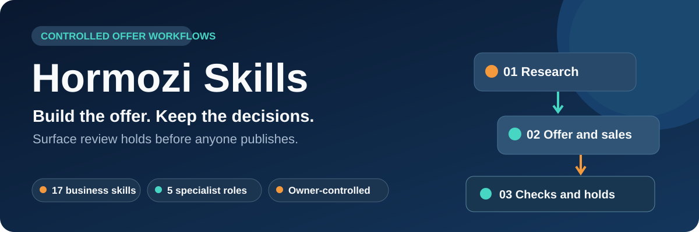
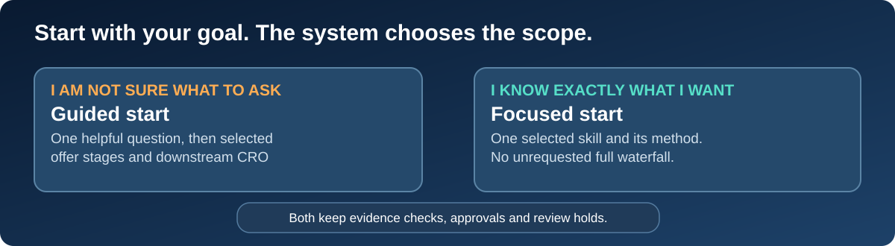
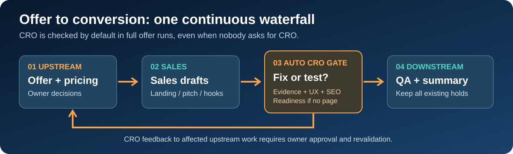
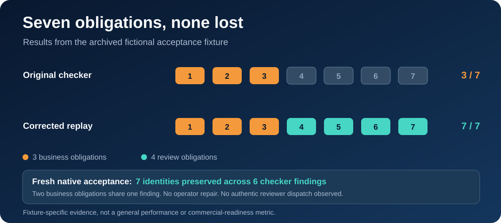
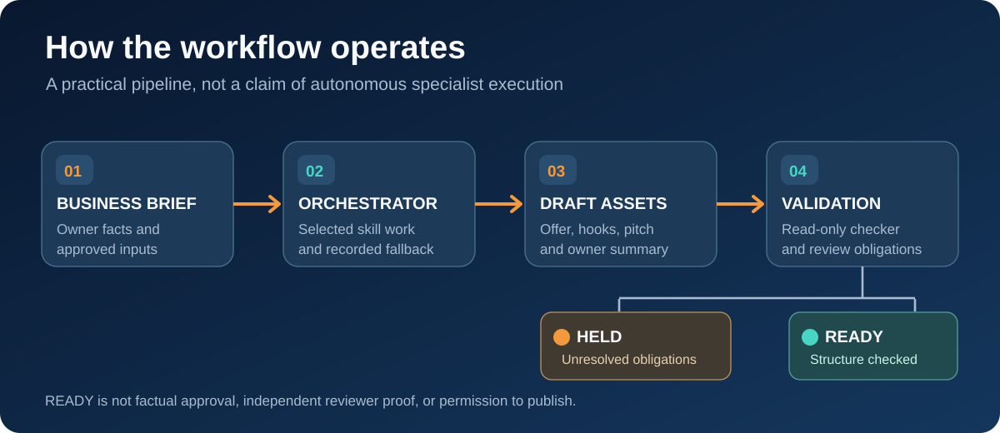

# Hormozi Skills



**Structured AI offer workflows with review gates and owner-controlled decisions.**

**Latest merged feature baseline: [PR #5](https://github.com/simpliolabs/hormozi-skills/pull/5), merged November 6, 2026** ([merge commit `862f3c7`](https://github.com/simpliolabs/hormozi-skills/commit/862f3c770f8264750c7c288506f02aedb0cbdb29)). It adds adaptive QUICK / GUIDED / opt-in DEEP routing, the CRO Page Optimizer, downstream CRO readiness for eligible offer workflows, and deterministic commercial-hold checks. [PR #4](https://github.com/simpliolabs/hormozi-skills/pull/4) merged the onboarding/visual update first.

**Source vs. release:** These capabilities are in the repository's `main` source. The plugin and marketplace manifests still declare **`1.1.1`**; no new versioned marketplace release or host auto-update has been verified. For the latest source, use a fresh clone of `main` and confirm your host is loading that checkout, not an older plugin cache.

[](https://www.instagram.com/nir_theceo)
[](https://x.com/NirAppelton)
[Personal website: nirappelton.com (coming soon)](https://nirappelton.com)


---

> An open-source, Hormozi-inspired skill library for Claude Code and Codex. Use standalone methods or a one-chat orchestrator to draft offers and sales materials. Controlled runs record business decisions, review obligations, and structural validation findings. Drafts do not constitute verified commercial claims or publication approval.

---

## Start here: one sentence is enough



**You don't need to know the names of the skills.** After installing the library, describe the goal in ordinary language:

| I'm starting with... | Say this | What happens |
|---|---|---|
| **No idea where to begin** | "I have a business idea. Help me figure out where to start." | One useful question, then the smallest relevant offer route |
| **An existing offer** | "My offer isn't converting. Find what is wrong first." | Diagnose before rewriting, then work on affected stages only |
| **A complete offer project** | "Build my offer and the sales assets from my business facts." | Full selected upstream → downstream waterfall, including CRO readiness |
| **One precise task** | "Write five hooks for this approved offer." | Only the hooks skill and common evidence checks |
| **A page or checkout issue** | "Review this screenshot and Clarity data for conversion problems." | CRO Page Optimizer directly, without rebuilding the offer |

**The rule:** **Small question = small workflow. Full offer = full selective waterfall.** Each specialist's method is loaded only when needed. Even a full run never automatically loads all 18 business skills.

[**Start Here guide**](docs/START_HERE.md) · [Adaptive routing and token discipline](references/adaptive-routing.md) · [Quick Start installation](#quick-start)

**Activation note:** Natural-language skill discovery depends on the host and is not guaranteed. In Claude Code, use the installed skill menu if needed; in Codex use its installed skill selector (such as `$hormozi-orchestrator`), and in ChatGPT use `@` if that skill is available. A short `/offer` alias is still a proposal, not a currently supported command.

---

## The Problem

Building a compelling offer is hard. Most founders, coaches, and consultants either:

- Write vague offers that don't convert — *"I help people grow their business"*
- Price wrong — too low to be taken seriously, too high without justification
- Skip the sales layer entirely — no hooks, no pitch, no landing page copy

**hormozi-skills** provides a structured workflow: 18 business skills including `cro-page-optimizer`, a `hormozi-orchestrator` entry skill, five specialist role definitions, and output validation. The orchestrator requests specialist delegation when available; actual execution and any fallback must be reported, not assumed.

---

## CRO is part of the offer waterfall by default



The V1 **full orchestrator** instructions include an **evidence-led CRO readiness check downstream** of offer/value/pricing and sales drafts. They say you do **not** need to say "run CRO" for an eligible full-offer request, and direct the root to write `output/CRO_REVIEW.md` before the final summary and checker. The check asks: Is the buyer's next action clear? Are material terms and proof credible? Is there an actual friction barrier to fix before testing copy?

This V1 routing is an instruction-level obligation, observed in a [bounded native full-offer run](https://github.com/simpliolabs/hormozi-skills/blob/48ee079ad87890d5e2b4641473d21738d1198d97/docs/qa/pr5-fictional-business/native-acceptance-fix-2026-11-06/README.md), not a universal runtime guarantee. The helper plans eligibility and depth; the checker cannot detect a root that omits CRO from the brief entirely. In ready mode with valid brief and run state records, existing manifest and file checks require `CRO_REVIEW.md` once requested. No measured token savings follow from this routing rule: the corrected full-offer run used more tokens than the original.

| Offer situation | Automatic CRO result |
|---|---|
| Live website, checkout or form | Evidence-led page and funnel audit if source is accessible; otherwise report missing evidence |
| New online offer, no page yet | Conversion-readiness preflight; never claim measured drop-off or visual QA |
| Offline/referral-led offer | Buyer-handoff review; mark irrelevant SEO and page checks `NOT APPLICABLE` |
| One focused skill task | No heavyweight waterfall; run the requested task only |

**Waterfall:** market (when needed) -> offer -> value -> pricing feasibility -> owner decisions -> sales drafts -> **CRO fix/test/hold gate** -> downstream revalidation -> SUMMARY -> structural QA. A CRO finding can reopen an affected upstream step, but **never silently change approved pricing, claims, guarantees, eligibility or scope**; dependent artifacts and review receipts must be rechecked.

**Run the CRO skill directly:** Select `cro-page-optimizer` where installed, or ask: *"Audit this landing page and find the first barrier to conversion using my screenshots and analytics."* It can also review organic search-intent match and propose a properly isolated A/B test.

See [CRO skill method](skills/cro-page-optimizer/SKILL.md), [public six-gate framework](skills/cro-page-optimizer/references/CRO_FRAMEWORK.md) and [waterfall contract](references/cro-waterfall.md).

---

## What has actually been validated

**Current verification includes PR #5, not just the earlier PR #3 baseline.** These are source and bounded fictional-workflow results, not commercial performance or a plugin distribution release.

| Check | Evidence-backed result |
|---|---|
| Latest source merge | [PR #5 merged](https://github.com/simpliolabs/hormozi-skills/pull/5) as [`862f3c7`](https://github.com/simpliolabs/hormozi-skills/commit/862f3c770f8264750c7c288506f02aedb0cbdb29); PR #4 onboarding docs merged separately |
| Exact pre-merge CI | [Final PR #5 Windows and Ubuntu checks passed](https://github.com/simpliolabs/hormozi-skills/actions/runs/42266056918): **342 tests and one skip per OS** plus repository checks, at reviewed PR head `31f5cb2` |
| Beginner guidance | **PASS, bounded**: selected the guided entry and asked one question; full novice persistence/journey was not proven |
| Focused expert request | **PASS**: exactly five hooks, only the hooks method loaded; no full offer/CRO waterfall |
| Full fictional offer | **PASS** at corrected runtime source `7b37ac3`: downstream CRO ran without an explicit request, the first-completion checker kept the workflow `HELD`, and **all seven business/review obligation identities remained explicit** without operator edits |
| Standalone CRO audit | **PASS, bounded**: found the planted mobile/form/unsupported-proof issues from supplied HTML and synthetic analytics; native browser rendering was unavailable |
| Separate review | Exact-source code and final-documentation reviews reported PASS within their recorded scopes, **not** authenticated GitHub approval or independent sales-copy approval |
| Unproven capabilities | Differentiated native specialist dispatch, automatic CRO detection if root omits it from the brief, native screenshot QA, token savings and general real-business reliability |

[Corrected native DeskFern evidence and 40-criterion matrix](https://github.com/simpliolabs/hormozi-skills/blob/48ee079ad87890d5e2b4641473d21738d1198d97/docs/qa/pr5-fictional-business/native-acceptance-fix-2026-11-06/README.md) · [Final documentation review](https://github.com/simpliolabs/hormozi-skills/blob/512364ab0265696d56fac52a213267590523d1aa/docs/qa/pr5-fictional-business/final-doc-closure-2026-11-06/README.md) · [Historical PR #3 acceptance](docs/SEVEN_HOLD_VALIDATION.md)

**Historical baseline illustration (PR #3 only):** it compares seven identities represented across six findings. PR #5's corrected checker can emit additional distinct commercial findings, so this chart is not the latest checker finding-count report.



### How the system works



**Independent-review floor:** Controlled sales artifacts keep review holds even when an author marks `high_risk` false or leaves it out. Missing/failed/stale/same-context receipts do not satisfy separate-context review. See the [review policy](references/orchestration.md) and [validation evidence](docs/SEVEN_HOLD_VALIDATION.md).

**Commercial-hold floor:** For controlled priced offers, including normal Stage A/B/D ready-mode runs, the read-only checker derives separate refund/cancellation and delivery-cost/financial-feasibility holds from structured `OFFER_DECISIONS`. Unknown or proposed terms do not become approved because a free-text blocker is generic or the workflow is already `HELD`. Stage C/E work without a requested or manifested pricing artifact or active final-feasibility task is outside this specific floor. Authorization and evidence references are cooperative metadata, not authenticated approval or proof of profitability.

A `READY` check is structural only. Pricing, guarantees, eligibility, claims, publication and external business actions remain under the owner's control.

---

## Quick Start

> **Install this fork:** The source below is `simpliolabs/hormozi-skills`. The original project by [Alex Smedile](https://github.com/alexsmedile/hormozi-skills) retains its attribution and MIT license.
>
> **Latest-source check:** Install or clone the **current `main`** for post-PR #5 features, then confirm the installed skill files and commit. The manifests still say `1.1.1` and a cached marketplace install may not match latest source. A marketplace version bump and release need separate approval.

### Claude Code

Add the marketplace, then install the plugin:

```bash
/plugin marketplace add simpliolabs/hormozi-skills
/plugin install hormozi-skills@hormozi-skills
```

Then invoke the `hormozi-orchestrator` agent or skill, or a specific business skill.

### Codex

Register the marketplace (a local clone of this repository, or its GitHub source), then install. The marketplace root is the repository root:

```bash
codex plugin marketplace add <path-to-clone-or-repo>
codex plugin list --available
codex plugin add hormozi-skills@hormozi-skills
```

Use the `hormozi-orchestrator` skill as the one-chat entry. If your Codex build does not discover it automatically, invoke it manually by naming the absolute path to its `SKILL.md` in your prompt. Non-interactive runs use `codex exec "<prompt>"`, and an interrupted run continues in the same session with `codex exec resume --last "<prompt>"` (both subcommands are listed by `codex exec --help`). Automatic activation and model/effort switching are not promised. The optional `.codex/` role adapters apply only when you work inside a trusted checkout of this repository; they are not copied into your project and do not register roles for a plugin installed elsewhere.

### Manual Install

If you want the raw skill files instead of the plugin flow:

```bash
# Clone the skill library
git clone https://github.com/simpliolabs/hormozi-skills.git
cd hormozi-skills

# Copy skills, agents AND the shared assets the skills load by plugin_root
cp -r skills/ agents/ references/ contracts/ scripts/ ~/.claude/
pip install -r requirements-qa.txt   # only for the optional output check
```

Skills and agents resolve `<plugin_root>/references/...` and `<plugin_root>/scripts/check_outputs.py` from their own base path, so `references/`, `contracts/` and `scripts/` must sit beside `skills/` and `agents/`. Output always goes to your project's `output/`, never into `~/.claude/`.

> [!TIP]
> Describe your business in plain language — rough idea, brain dump, or existing offer. The orchestrator interviews you, detects your stage, and builds everything from there.

---

## 📦 What You Get

The 11 business-content files below are generated as applicable. Controlled multi-step runs also produce `output/SUMMARY.md`, state, checkpoint, and QA records; not every focused request generates every artifact:

| File | What's Inside |
|------|--------------|
| `MARKET_RESEARCH.md` | Niche and pain analysis, with source-backed signals where available; missing market validation stays explicit |
| `OFFER.md` | Full Grand Slam Offer — avatar, obstacles, solution map, value stack |
| `OFFER_ANGLES.md` | 8 positioning angles, ranked |
| `OFFER_AUDIT.md` | Score per dimension + priority fixes |
| `VALUE_PERCEPTION.md` | Improved naming, packaging, framing |
| `BONUS_STACK.md` | Objection-killing bonus structure with perceived value |
| `PRICING.md` | Value-anchored price, tiers, justification story |
| `OBJECTIONS.md` | Hidden beliefs, belief shifts, DM-ready responses |
| `PITCH.md` | Short / medium / long pitch versions |
| `HOOKS.md` | 30+ hooks across 10 types, ranked |
| `LANDING_PAGE.md` | Full landing page copy, section by section |

---

## 🧠 Skills Library

Use any skill standalone — no orchestrator needed:

| Skill | Purpose |
|-------|---------|
| `hormozi-offer` | Build a Grand Slam Offer from scratch → `OFFER.md` |
| `hormozi-pitch` | Pitch deck and sales narrative |
| `hormozi-hooks` | Hook and headline generation (30+ hooks) |
| `audit-offer` | Score and rewrite an existing weak offer |
| `bonus-stack` | Build a bonus stack that kills objections |
| `business-model` | Choose and structure the right business model |
| `dfy-dwy-diy` | Frame offer as DFY / DWY / DIY tiers |
| `effort-reduction` | Reduce perceived effort in the offer |
| `idea-to-product` | Turn rough idea into productized offer |
| `landing-page-copy` | Generate landing page copy from an existing offer |
| **`cro-page-optimizer`** | **Evidence-led SEO, mobile UX, funnel friction and A/B planning; default downstream gate in full offer runs** |
| `market-research` | Research market pain and demand signals |
| `objection-destroyer` | Map and neutralize common objections |
| `offer-angles` | Generate multiple positioning angles |
| `pricing-strategy` | Price anchoring and packaging |
| `productize` | Productize a service business |
| `value-accelerator` | Increase perceived value |
| `value-perception` | Improve how value is communicated |

> [!TIP]
> Skip the orchestrator and call any skill directly: `/audit-offer`, `/pricing-strategy`, `/landing-page-copy` — each works standalone with no prior context needed.

---

## 🔀 Agent System

```
hormozi-orchestrator
├── sub-market    → MARKET_RESEARCH.md
├── sub-offer     → OFFER.md + OFFER_ANGLES.md
├── sub-value     → OFFER_AUDIT.md + VALUE_PERCEPTION.md + BONUS_STACK.md
├── sub-pricing   → PRICING.md + OBJECTIONS.md
└── sub-sales     → PITCH.md + HOOKS.md + LANDING_PAGE.md
```

**Dependency order:** market → offer → (value ∥ pricing) → sales

The orchestrator selects tasks based on the owner's stage. It requests native specialist delegation where available, and must record refusal, fallback or unknown execution instead of claiming agents ran.

---

## ⚙️ How It Works

1. **Intake** — give the orchestrator anything: a raw idea, existing offer, brain dump, or sales page
2. **Interview** — focused questions one at a time, each with a suggested answer
3. **Stage detection** — classifies your situation (Stage A–E), shows which subagents will run
4. **Delegation** — requests specialists in dependency order where supported, recording any observed fallback or refusal
5. **Automatic CRO gate** — after accepted sales drafts, reviews the offer-to-conversion path or marks unavailable page evidence; can request an owner-approved upstream fix
6. **Summary and checks** — produces `output/SUMMARY.md` with an offer paragraph, key decisions/holds, a chosen hook, and exactly three prioritized owner actions, then runs structural validation and reports HELD findings honestly

---

## Repo Structure

```
hormozi-skills/
├── skills/     # 20 directories: 18 business methods + orchestrator + create-plugin
├── agents/     # Orchestrator + 5 subagents
├── references/ # Shared workflow, evidence and feasibility contracts
├── contracts/  # JSON schemas for run records
├── scripts/    # check_outputs.py local acceptance checks
├── .codex/     # Optional Codex role adapters (trusted checkout only)
├── output/     # Generated offer documents (starts empty)
└── input/      # Drop existing offers, notes, or sales pages here
```

---

## Safe first use

Start with a **supervised, non-public** offer draft using verified inputs. Invoke `hormozi-orchestrator` in an installed checkout or use a focused skill. Review `output/CRO_REVIEW.md` (in full offer runs), `output/SUMMARY.md`, `output/CHECKPOINT.md`, `output/QA_REPORT.md`, and the output checker's findings. Resolve or disclose unresolved business and independent-review obligations before any external use. The checker does not automatically verify market reality.

See [Operator guide](docs/OPERATING_GUIDE.md) for a first-run checklist, limitations and release boundaries.

---

## Who This Is For

- Founders, coaches, consultants, and freelancers building offers
- Anyone applying Hormozi's methodology who wants AI execution, not just AI advice
- Coding agents running offer-generation pipelines

## Who This Is Not For

- Generic copywriters looking for fill-in-the-blank templates — this thinks, it doesn't just fill
- Developers needing a code library — this is prompt-based, agent-native
- People seeking publication-ready commercial claims without verifying the underlying business facts and approvals

---

## Frameworks

Built on Alex Hormozi's offer methodology from *$100M Offers* and *$100M Leads*:

- Grand Slam Offer construction
- Value Equation: (Dream Outcome × Perceived Likelihood) / (Time Delay × Effort and Sacrifice)
- Obstacle → solution reversal
- Value stack and bonus engineering
- Guarantee design (unconditional / conditional / effort-based)
- Price anchoring and perceived value
- Hook architecture (pattern interrupt, identity, outcome, curiosity)

---

## Who builds and maintains this fork?

**Original project:** [Alex Smedile](https://github.com/alexsmedile) created the original Hormozi Skills project. The original MIT copyright and attribution are retained. This is a fork, not a claim to have authored the upstream library.

**This fork:** [Simpliolabs](https://github.com/simpliolabs) maintains this repository. **Nir Appelton** provides project direction for the updated offer workflows, orchestration review gates, and practical usage experience. Contributions are recorded in the Git history and pull requests; the [PR #3 acceptance record](docs/SEVEN_HOLD_VALIDATION.md) describes exactly what has been tested.

**Why we're working on it:** To make AI-assisted offer creation more practical, transparent, and accountable to the business owner. It should produce useful drafts and preserve decisions requiring human review, rather than imply that unverified business claims have been proven.

**Connect with Nir Appelton**

- Website: [nirappelton.com](https://nirappelton.com) **(coming soon)**
- Instagram: [@nir_theceo](https://www.instagram.com/nir_theceo)
- X: [@NirAppelton](https://x.com/NirAppelton)

### What this fork does not claim

This is not an official Alex Hormozi product or an endorsement. PR #5's corrected first-completion acceptance was a bounded fictional workflow, not a general commercial endorsement. Business validation, authenticated sales-copy review, differentiated native specialist dispatch, automatic CRO eligibility enforcement when root omits its declaration, and measured token efficiency remain unproven. Business decisions and publication remain with the owner.

---

## Credits

Original author: [Alex Smedile](https://github.com/alexsmedile). Fork maintenance: [Simpliolabs](https://github.com/simpliolabs), with project direction by [Nir Appelton](https://nirappelton.com) (personal site coming soon). Inspired by Alex Hormozi's publicly described frameworks; not affiliated with or endorsed by Alex Hormozi. Licensed under [MIT](LICENSE).
